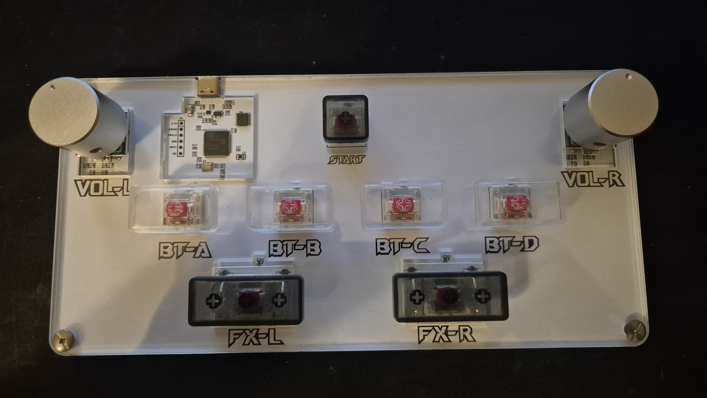
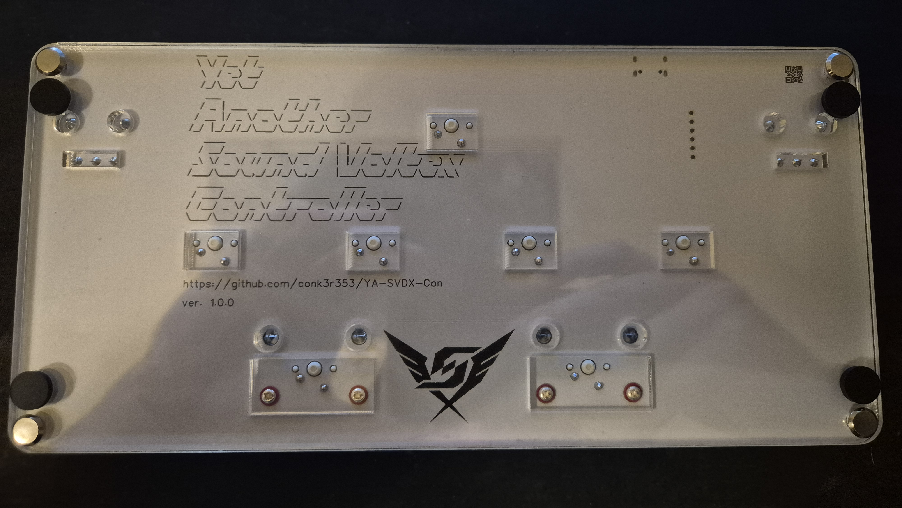

# Yet Another Sound Voltex Controller

(yeah, writing your own GitHub link on PCB silkscreen without a typo is hard, man...)

## Features

-	Simple to use, produce and modify PCB based on STM32 microcontroller
-	Compatible with any HID Gamepad supporting game
-	Under-button LEDs reacting to each button press
-	See-through acryllic case
-	1 kHz polling rate

## Disclaimer

This project's main goal in mind is to learn how to work with STM32 and how to handle small-batch manufacturing. Everything is provided as-is, I am not responsible for any losses that may result from using this project. I did everything I can to ensure that everything is accurate and functional, but I am just a human and I can be wrong.

## License

This project is provided for personal, educational, and other non-commercial use.

You are free to study, reproduce, modify, and share the design files and derivative designs, provided that you comply with the terms of the Creative Commons Attribution-NonCommercial-ShareAlike 4.0 International License (CC BY-NC-SA 4.0).

This includes:
- electrical schematics
- PCB design files
- PCB layout
- acrylic enclosure CAD files
- technical drawings
- project documentation

Commercial use is not permitted without prior permission from the copyright holder.